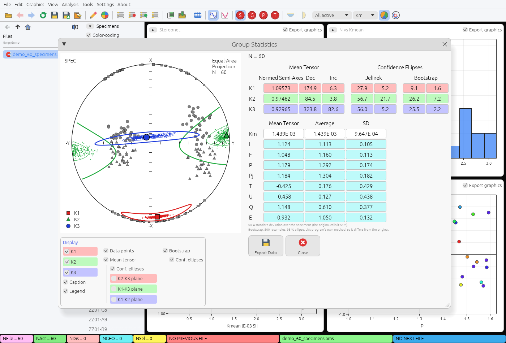
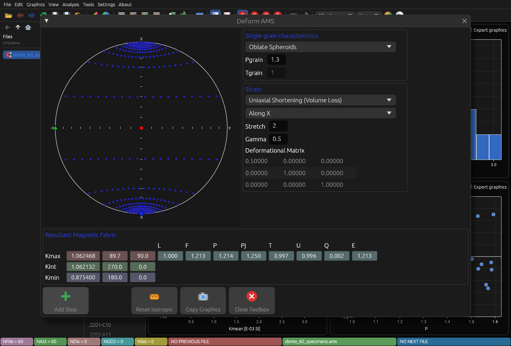
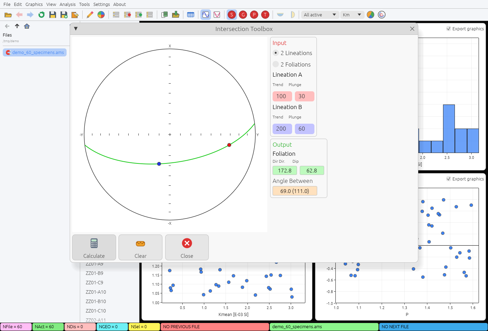

# AMS Studio

**AMS Studio is a fast, modern, open application for anisotropy of magnetic susceptibility (AMS) data**, built as a modern alternative to AGICO's Anisoft 6. It reads Safyr7 `.ams` files, gives the same numbers as the original (checked against it), keeps the original's menus, toolbar order and shortcuts, and adds the things the original never had: a **dark mode**, resizable panes, a file browser, drag selection, and a single executable for **Windows and Linux**.

> **Download (Windows):** [`dist/ams-studio-windows-x64.exe`](dist/ams-studio-windows-x64.exe), also attached to the [latest release](../../releases/latest). Double-click it, there is no installer. On Linux build from source (below). Try it with the made-up files in [`examples/`](examples).

| Light | Dark |
|---|---|
|  |  |

## What is better than the original

| | Original Anisoft 6 | AMS Studio |
|---|---|---|
| **Look** | One fixed light look | **Light and dark theme** (View menu, remembered), flat vector icons, rounded cards. The toolbar buttons are in the same places as in the original, so muscle memory carries over |
| **Layout** | Four plots at a fixed split | **Drag the dividers** between the plots, resize the Specimens list and the file browser. Window size, panel widths and dividers are **remembered** between runs |
| **Opening files** | File dialog, previous / next buttons | **Collapsible file browser** on the side (like a code editor): folders, back / up / home, click a file to open it, previous / next file in the folder |
| **Selecting** | Click rows | **Whole-row click**, **drag over rows**, **rubber-band** selection in the stereonet, P-Kmean and T-P plots. Hold **Ctrl / Alt / Shift** to pick only **K1 / K2 / K3** markers. **Esc** clears |
| **Keyboard** | Function keys | Function keys as before, plus **Q / E** previous / next specimen (the list follows), **W** switches in-phase / out-of-phase, **Esc** clears the selection |
| **Axes** | Linear or log per axis | **Log Km** checkbox on the P-vs-Kmean plot; log10 option for every axis and colour scale |
| **Popups** | Tool windows open in a different place every time | About **twice as large**, always open **centred at the same size** |
| **Exports** | Export all active records | Adds **Export Selection (CSV)** (Ctrl+Shift+E) for just the specimens you selected |
| **Install** | Windows only; installer that brings the Visual Basic 6 runtime and OCX controls | **One executable**, nothing to install, runs on **Windows and Linux** |
| **Trust** | Closed source | **Open source**, 42 automated tests, results checked against the original on its own output files (see below) |

Also: a new **application icon** (an AMS ellipsoid with its K1/K2/K3 axes); disregarded records **sink to the bottom** of the list and the Data Table, struck through and faded; the colour-coding panel, the Export graphics tick boxes and the status bar colours of the original are kept.

## What it can do

Everything below is in the program today.

- **Open and browse** Safyr7 `.ams` files (in-phase and out-of-phase), step through the files of a folder, reload.
- **Four live plots**, each with the option panel of the original (the arrow in its header):
  - **Every parameter can be plotted**: Kmean, L, F, P, Pj, T, U, Q, E, K1-K3 and their declinations/inclinations, the F-tests and the E12 / E23 / E13 confidence angles. The picker opens as one wide panel with the parameters **grouped by type** in coloured columns.
  - **Axes**: any parameter on X and Y, auto-scale or a fixed range, **linear or log10**, diagonal line, conf. intervals (error bars for K1-K3), connect symbols, caption, legend.
  - **Colour-coding** of the markers by any parameter (rainbow, shades or grayscale, auto or fixed scale, linear or log), with a **colour scale bar under each plot** showing the range and the parameter name.
  - **Stereonet extras**: K1/K2/K3 on or off, magnetic-foliation circles, **mean tensor with Jelinek confidence ellipses and K2-K3 / K1-K3 / K1-K2 planes**, **bootstrap cloud**, connect symbols.
  - **Histogram** of any parameter with adjustable bins. Hover for values, click to select. The marker size is **6 by default** and your last choice is remembered.
- **Coordinate systems** S, G, P, T and the in-phase / out-of-phase switch (F3 / F4 / **W**).
- **Data Table** with all parameters (Km, K1-K3 with directions, P, Pj, T, F-tests...), whole-row selection, disregarded records last.
- **Group Statistics** (F9) with the original's colour-coded tables and a stereonet with data points, mean-tensor axes, **Jelinek confidence ellipses**, optional great-circle planes and a **bootstrap cloud**; display toggles for everything.
- **Contour Plot** (F12) for K1, K2, K3: continuous or discrete levels in the axis colour, adjustable smoothing, contour lines, data points, eigenvectors with their eigenvalue table, colour scale.
- **Tools menu**, all five windows: **GED Editor** (read/write `.ged` files), **Tensor Addition / Subtraction** (pair two files by specimen name, add or subtract tensors, save), **Fabric Overprint** (mix two fabrics, simulate the series), **Intersection Toolbox** (two lineations to a plane, two foliations to a lineation, with the net drawn), **Deform AMS** (grain-population model with seven strain types, step by step).
- **Edit** (rename specimens, invert / disregard / restore / clear selection), **Save Active Records As**, **Append Selected Records Into** (records are copied byte for byte), **Export CSV**, **Export Selection (CSV)**.
- **Graphics**: copy to the clipboard or save PNGs of the plots you tick under *Export graphics*.

### Screenshots

| Group Statistics (light) | Group Statistics (dark) |
|---|---|
|  |  |

| Contour plot (K2, discrete, all overlays) | Deform AMS after three steps (dark) |
|---|---|
|  |  |

(All screenshots use the made-up demo files; no measurement data is in this repository.)

## Same results as the original

The numbers were checked by running the original Anisoft 6 on made-up data and comparing what it printed or wrote:

| Area | Agreement with the original |
|---|---|
| Km, K1-K3, L, F, P, Pj, E, F-tests (88 specimens) | about 1e-7 relative |
| Principal directions | under 0.002 degrees |
| T, U, Q | about 1e-5 |
| Group statistics: mean tensor, Jelinek ellipse angles, shape parameters, averages and standard deviations | **exact** on two files (N = 12 and N = 60) |
| Contour eigenvector table | matches to 5 digits |
| Tensor Addition / Subtraction (86 pairs, both phases) | identical |
| Fabric Overprint series | 1e-7 |
| Intersection Toolbox | exact |
| Deform AMS (prolate and oblate grains, step order, all strain types) | about 1e-6 |
| `.ged` files | written byte for byte like the original |

Each check is reproducible: `cargo run -p ams-core --example validate` and `--example check_tools` compare against files exported by the original, and `cargo test` contains regression tests built from numbers the original printed.

## Not (yet) the same

Honest list of the gaps:

- **Per-specimen orientation.** The original takes geographic, paleo and tectonic coordinates from orientation values stored in each `.ams` record (written by *Edit Data* from a `.ged` file). Here the G / P / T views use the global values in *Settings > Orientation Parameters*, which is only an approximation. The geographic and paleo rules are decoded (see [`docs/ORIGINAL_BEHAVIOUR.md`](docs/ORIGINAL_BEHAVIOUR.md)); the tectonic rule is not.
- **Bootstrap ellipses** are this program's own method (500 resamples, 95 % region) and differ from the original's.
- **Contour density** is very close to the original (colour-scale maxima within about 3 %) but not identical.
- **Not exact:** the E12 / E23 / E13 confidence angles are computed from the stored standard deviations and match the original to about 5 % (it uses the full covariance, which the files do not contain). The stereonet's *Foliation* / *Lineation* options need `.ged` data and are not available.
- **Not implemented:** import of `.asc` / `.ran` files, *Set Data Classes*, Paleo-Horizontal / Paleo-Vertical, and the contour inputs *Foliation Pole* / *Lineation* (they need the orientation data above). Their menu items are present so the layout matches.
- Deform AMS starts from the isotropic grain population; the original starts from the fabric of the open data.

## Run it

**Windows 10 / 11 (64-bit):** download [`dist/ams-studio-windows-x64.exe`](dist/ams-studio-windows-x64.exe) (SHA-256 in `dist/ams-studio-windows-x64.exe.sha256`) and double-click it. The executable is not code-signed, so Windows SmartScreen may say "unknown publisher": choose *More info* then *Run anyway*. Preferences are kept in `%APPDATA%\ams-studio\state.txt` (delete it to reset the layout).

**Linux:** build from source (below); the binary needs a Wayland or X11 session. Preferences are in `~/.config/ams-studio/state.txt`.

**From source:** `cargo run --release -p ams-studio -- examples/demo_60_specimens.ams` (a recent stable Rust; no other dependencies).

The program never uses the network.

### Keyboard

| Key | Action | Key | Action |
|---|---|---|---|
| Ctrl+O / P / N / R | open / previous / next file / reload | F3 / F4 / **W** | in-phase / out-of-phase / switch |
| Ctrl+S / A | save active as / append selected | F5 - F8 | S, G, P, T coordinates |
| Ctrl+E / **Ctrl+Shift+E** | export all / **export selection** (CSV) | F9 / F12 | group statistics / contour |
| Ctrl+C / Ctrl+F | copy / save graphics | F2 | data table |
| Shift+Ins / Shift+Del / Alt+Backspace | invert / disregard / restore all | **Q / E** | previous / next specimen |
| **Esc** | clear selection | Ctrl+B | show / hide the file browser |

Mouse: click a row or marker to select, **drag over rows** or **drag a rubber band** in a plot to select several; with **Ctrl / Alt / Shift** held the band only picks K1 / K2 / K3 markers. Drag the dividers between plots and the panel edges to resize.

## For developers and other LLMs

Everything needed to follow or redo the work is in the repository:

- [`AGENTS.md`](AGENTS.md): repository map, commands, rules.
- [`docs/ORIGINAL_BEHAVIOUR.md`](docs/ORIGINAL_BEHAVIOUR.md): every rule recovered from the original, with how closely it is verified.
- [`docs/FORMATS.md`](docs/FORMATS.md): the `.ams` record layout, `.ged`, csv, preferences.
- [`docs/RECREATING.md`](docs/RECREATING.md): how the original was studied (installer and VB6 structure, REA + Ghidra, the black-box calibration rig), the traps, architecture, egui 0.37 specifics, headless testing, open items.

## Legal

AMS Studio is an independent application written from observed behaviour of AGICO's Anisoft 6. It contains **no AGICO code, binaries, icons or screenshots**. Anisoft and Safyr are products of AGICO, Brno; this project is not affiliated with or endorsed by AGICO. The `.ams` layout was worked out from files; check your own licence terms if that matters for your use. MIT licensed.
