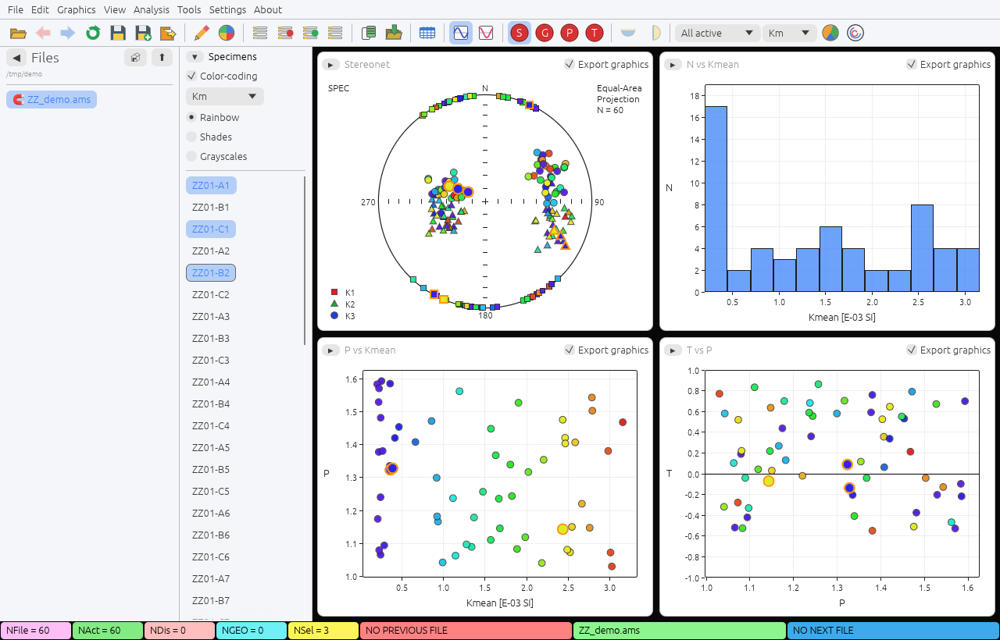
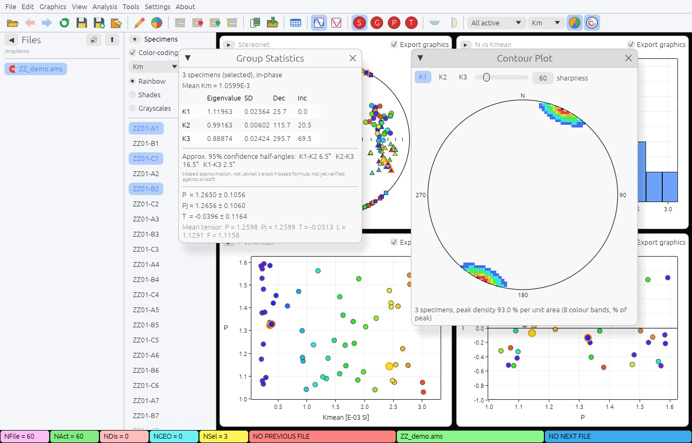

# Anisoft for Linux

An independent, native Linux reimplementation of AGICO's **Anisoft 6** (anisotropy of magnetic susceptibility, AMS), written in Rust with [egui](https://github.com/emilk/egui).

It keeps the original's window: the same menus, shortcuts and toolbar button order, the Specimens list, the four plots (stereonet, N vs Kmean, P vs Kmean, T vs P) and the coloured status bar. On top of that:

- **Resizable panes**: drag the dividers between the four plots, and the edges of the Specimens list and the file browser.
- **Collapsible file browser** on the left (Ctrl+B), listing `.ams` files; click one to open it.
- A modern look with a light and a dark theme (View > Dark Theme).




(Screenshots use made-up data from `make_demo`.)

## Build and run

```
cargo run --release -p anisoft -- [file.ams]
```

Needs a Rust toolchain; on Fedora the Wayland/X11 libraries come with the desktop. Tests: `cargo test`.

## What works

| Area | Status |
|---|---|
| Open / previous / next / reload `.ams` (Safyr7) | works; previous/next walk the `.ams` files in the folder |
| In-phase and out-of-phase AMS (F3 / F4) | works |
| K1-K3, Dec/Inc, L F P Pj T U Q E, F-tests | works, matches Anisoft's csv export (see below) |
| Four plots, selection, disregard / restore, invert / clear | works |
| Colour-coding by Km, P, Pj or T (rainbow / shades / grayscale) | works |
| Data Table (F2), Group Statistics (F9), Contour Plot (F12) | works (see caveats) |
| Save active records as `.ams`, append selected records into an `.ams`, export CSV | works; subsets are copied byte for byte |
| Copy graphics to clipboard, save graphics (one PNG per ticked plot) | works |
| Edit Data (rename a specimen) | works |
| Selecting | click a row (the whole row is the target), drag over rows, Ctrl+drag to add; drag a rubber band in the stereonet, P-Kmean and T-P plots. In the stereonet hold **Ctrl** (K1), **Alt** (K2) or **Shift** (K3) to pick only that marker type (combine keys for several) |
| Disregarded records | moved to the bottom of the list and the table, struck through and very faint |
| Windows | every menu item opens its window at the same centred place with the same size, however often you use it |
| Tools > GED Editor | works: open / edit / save `.ged` files (byte-identical to the original's layout) |
| Tools > Tensor Addition / Subtraction | works, matches the original bit for bit on 86 pairs (in- and out-of-phase) |
| Tools > Fabric Overprint | works, matches the original (max error 1e-7); replaces the data with the simulated series |
| Tools > Intersection Toolbox | works, matches the original's numbers and plot |
| Tools > Deform AMS | works, matches the original to about 1e-6 (7 test cases, prolate and oblate grains, step order, all strain types) |
| Coordinates S / G / P / T (F5-F8) | works with user-set orientation parameters, conventions unverified |

## Not implemented yet

Import Data File(s) (`.ran`, `.asc`), Set Data Classes, and Paleo-Horizontal / Paleo-Vertical. Their menu items and buttons are present so the layout matches; most show a short "not implemented yet" note. Edit Data only renames a specimen: the original also stores per-specimen orientation values (from a `.ged` file) in the `.ams` records, which this version does not read or write yet.

## Caveats

- Group Statistics: the mean tensor and eigenvalues are standard, but the confidence half-angles use a Student-t approximation, not Jelinek's exact F-based formula, and have not been compared with Anisoft.
- Orientation: G / P / T use the global values in Settings > Orientation Parameters. The original instead reads per-specimen values stored in each `.ams` record (set through Edit Data with a `.ged` file). Its geographic rule has been worked out (see `reference/tools-spec.md` in the checkout) but is not built in yet, so treat G / P / T here as approximate. The rotation conventions (core azimuth/dip, bedding strike/dip, paleo declination) are documented in `anisoft-core/src/coords.rs` and have not been checked against Anisoft's own dialog.
- Km is shown exactly as stored. No specimen-volume correction is applied.
- Contour Plot uses an exponential kernel density, not Anisoft's exact contouring.

- Tensor Addition: Find Duplicates keeps the first record of each name and disregards the rest; the original's exact rule was not checked. Deform AMS starts from the isotropic grain population, whereas the original starts from a fabric taken from the main window.

## Validation

The `.ams` reader and the tensor maths were checked against a csv exported by the original Anisoft 6 for an 88-specimen file. Over all 88 specimens: Km, K1-K3, L, F, P, Pj, E and the F-tests agree to about 1e-7 (relative), principal directions to under 0.002 degrees, T, U and Q to about 1e-5.

```
cargo run -p anisoft-core --example validate -- file.ams anisoft_export.csv
```

(Specimens are joined on Km, because names can differ between a csv and an `.ams` that was renamed afterwards.)

The Tools were checked the same way, against files the original wrote: `cargo run -p anisoft-core --example check_tools -- A.ams B.ams added.ams subtracted.ams overprint.ams`.

## Layout

- `crates/anisoft-core`: `.ams` parsing (`ams`), eigen-decomposition and anisotropy parameters (`tensor`), coordinate systems (`coords`), group statistics (`stats`), contour density (`density`), CSV export (`export`), `.ged` files (`ged`) and the Tools maths (`tools`).
- `crates/anisoft`: the egui application.
- `crates/anisoft-core/examples/make_demo.rs`: writes a made-up `.ams` for demos and screenshots.

## `.ams` layout

Fixed 640-byte records, no header. Name at byte 0; field (A/m) at 28; frequency (Hz) at 40; instrument text at 44; reference volume (10.0 cm3) at 68; the in-phase block at 180 and the out-of-phase block at 324 (144 bytes each). Inside a block: Km at +0, K1-K3 standard deviations at +20, the raw tensor at +32 in the order Tyy, Txx, Tzz, Txy, Txz, Tyz, and the F-tests at +128. K1-K3 are always recomputed from the tensor; the K1-K3 floats stored at +8 are not reliable.

## Legal

This is an independent reimplementation. It contains no AGICO code, binaries or assets. Anisoft is a program of AGICO, Brno; this project is not affiliated with AGICO.
