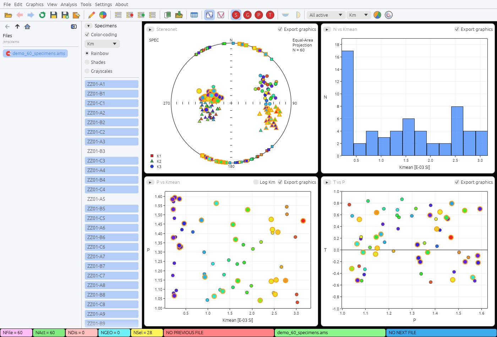
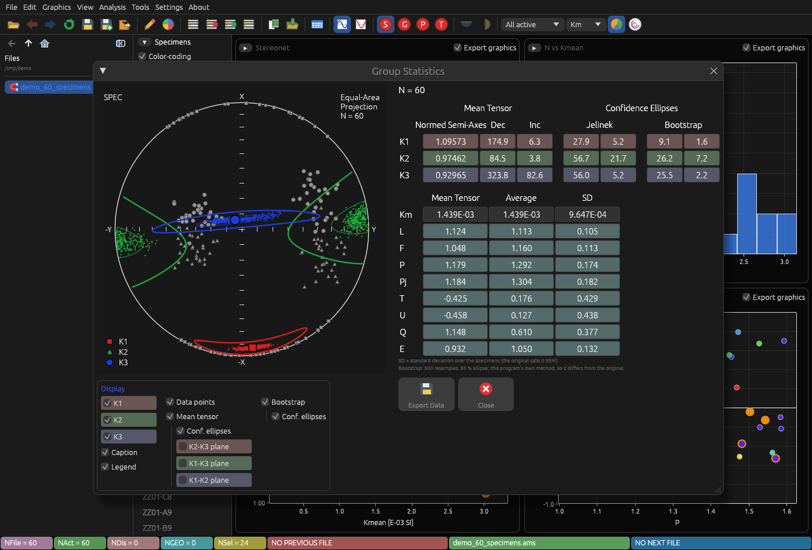

# AMS Studio

[AGICO](https://www.agico.com/) of Brno gave rock magnetism its instruments and its software: the Kappabridges, the Safyr data format and **Anisoft 6**, the program that has processed anisotropy of magnetic susceptibility (AMS) data in laboratories around the world for years. Anisoft 6 is the reference, and this project owes everything to it. **AMS Studio is not a replacement for Anisoft 6.** It is a companion for people who already work with it: a modern viewer that reads the same Safyr7 `.ams` files, reproduces the original's numbers (checked against its own output), keeps its menus, toolbar order and shortcuts, and adds a few conveniences around them: a **dark mode**, resizable panes, a file browser, drag selection, a map of where the specimens are, and a single executable for **Windows and Linux**.

> **Download (Windows):** [`ams-studio-windows-x64.exe`](https://github.com/egorsann/ams-studio/releases/latest/download/ams-studio-windows-x64.exe) from the [latest release](../../releases/latest) (the SHA-256 is next to it). Double-click it, there is no installer. After that the program tells you at the top right when a newer version exists and installs it with one click. On Linux, `ams-studio-linux-x64` is on the same page, or build from source (below). Try it with the made-up files in [`examples/`](examples).

| Light | Dark |
|---|---|
|  |  |

## Where AMS Studio differs from Anisoft 6

| | Anisoft 6 | AMS Studio |
|---|---|---|
| **Look** | One fixed light look | **Light and dark theme** (View menu, remembered), flat vector icons, rounded cards. The toolbar buttons are in the same places as in the original, so muscle memory carries over |
| **Layout** | Four plots at a fixed split | **Drag the dividers** between the plots, resize the Specimens list and the file browser. Window size, panel widths and dividers are **remembered** between runs |
| **Opening files** | File dialog, previous / next buttons | **Collapsible file browser** on the side (like a code editor): folders, back / up / home, click a file to open it, previous / next file in the folder |
| **Selecting** | Click rows | **Whole-row click**, **drag over rows**, **rubber-band** selection in the stereonet, P-Kmean and T-P plots. Hold **Ctrl / Alt / Shift** to pick only **K1 / K2 / K3** markers. **Esc** clears |
| **Keyboard** | Function keys | Function keys as before, plus **Q / E** previous / next specimen (the list follows), **W** switches in-phase / out-of-phase, **Esc** clears the selection |
| **Axes** | Linear or log per axis | **Log Km** checkbox on the P-vs-Kmean plot; log10 option for every axis and colour scale |
| **Popups** | Tool windows open in a different place every time | About **twice as large**, always open **centred at the same size** |
| **Exports** | CSV of one phase | **One CSV with in-phase and out-of-phase together**: one row per specimen, columns `ip_*` and `op_*` (Km, K1-K3 with SD, directions, L F P Pj T U Q E, F-tests, E12/E23/E13, the raw tensor) plus `opKm_over_ipKm_percent`. **Export Selection (CSV)** (Ctrl+Shift+E) does the same for just the selected specimens |
| **Install** | Windows only; installer that brings the Visual Basic 6 runtime and OCX controls | **One executable**, nothing to install, runs on **Windows and Linux** |
| **Source** | Proprietary | **Open source**, 42 automated tests, results checked against the original on its own output files (see below) |

Also: a new **application icon** (an AMS ellipsoid with its K1/K2/K3 axes); disregarded records **sink to the bottom** of the list and the Data Table, struck through and faded; the colour-coding panel, the Export graphics tick boxes and the status bar colours of the original are kept.

## What it can do

Everything below is in the program today.

- **Open and browse** Safyr7 `.ams` files (in-phase and out-of-phase), step through the files of a folder, reload.
- **Four live plots**, each with the option panel of the original (the arrow in its header):
  - **Every parameter can be plotted**: Kmean, L, F, P, Pj, T, U, Q, E, K1-K3 and their declinations/inclinations, the F-tests and the E12 / E23 / E13 confidence angles. The picker opens as one wide panel with the parameters **grouped by type** in coloured columns.
  - **Axes**: any parameter on X and Y, auto-scale or a fixed range, **linear or log10**, diagonal line, conf. intervals (error bars for K1-K3), connect symbols, caption, legend.
  - **Colour-coding** of the markers by any parameter (rainbow, shades or grayscale, auto or fixed scale, linear or log), with a **colour scale bar under each plot** showing the range and the parameter name.
  - **Stereonet extras**: K1/K2/K3 on or off, magnetic-foliation circles, **mean tensor with Jelinek confidence ellipses and K2-K3 / K1-K3 / K1-K2 planes**, **bootstrap cloud**, connect symbols.
  - **Histogram** of any parameter with adjustable bins. Hover for values, click to select. The marker size is **6 by default** and your last choice is remembered.
- **Coordinate systems** S, G, P, T and the in-phase / out-of-phase switch (F3 / F4 / **W**).
- **Data Table** with all parameters (Km, K1-K3 with directions, P, Pj, T, F-tests...), whole-row selection, disregarded records last.
- **Group Statistics** (F9) with the original's colour-coded tables and a stereonet with data points, mean-tensor axes, **Jelinek confidence ellipses**, optional great-circle planes and a **bootstrap cloud**; display toggles for everything.
- **Contour Plot** (F12) for K1, K2, K3: continuous or discrete levels in the axis colour, adjustable smoothing, contour lines, data points, eigenvectors with their eigenvalue table, colour scale.
- **Tools menu**, all five windows: **GED Editor** (read/write `.ged` files), **Tensor Addition / Subtraction** (pair two files by specimen name, add or subtract tensors, save), **Fabric Overprint** (mix two fabrics, simulate the series), **Intersection Toolbox** (two lineations to a plane, two foliations to a lineation, with the net drawn), **Deform AMS** (grain-population model with seven strain types, step by step).
- **Folder of specimens** (File > Open Folder of Specimens, Ctrl+Shift+O, or the button in the file browser; a folder given on the command line works too): pick the parent folder and every sub-folder with `.ams` files is listed as a specimen with all its files, like the tree of TX Studio. Naming differs between labs, so the identifier of the main file per specimen (the author's end in `_use`) is detected and shown as a sentence ("`_use` is the identifier of the main .ams file in each specimen folder") above the list of the files it picks. If nothing recurs the dialog says so and suggests renaming the files before using the program; *Search for another string* takes a text, matches it again and updates the list so you can check every specimen. Previous / Next then walk the main files. Like TX Studio, the program starts where you stopped: the folder of specimens, the identifier and the file that were open are restored (scanning happens in the background; the dialog only comes back if nothing matches any more). In the tree each specimen folder has a folder icon and a gray name, the file the identifier picked is listed first in bold, the other files follow in a darker shade, the file that is open has a coloured background (so you can follow Shift+Q / Shift+E on the left), and **Shift+Q / Shift+E** jump to the previous / next specimen folder while Q / E step through its sub-specimens.
- **Lab-sheet parameters** (the M3ORE sheet `Template_PrinSus`): the colour-coding picker also offers the volume-corrected Kmean, Khan's L and F, Owens' H, the unnormalised K1-K3, the lineation plunge and the foliation dip and dip direction, each in the group where it belongs and marked `*`, with a footnote. The csv export has them too, plus the lab sheet's fractional and absolute errors of L, F, P, Pj, T, U and the Khan / Owens parameters (columns are listed in `docs/FORMATS.md`).
- **Edit > Volume Correction**: the sample volume (and cubic or cylindrical) is written into the Volume field of the records; the shape and date go to `<file>.volume.json` next to the file after you have been told. Hovering the menu item shows the volume already applied to the open file. Km as shown stays as stored; the starred parameters use 10 / volume.
- **Edit > Recombine Split AMS Files**: joins `.ams` files exported in parts. Drag the parts into the order they follow each other, accept or untick the suggestions (order by specimen ID with A1 B1 C1 A2 ... or A1 A2 B1 ..., leave out identical records, one record per name), tick single records in or out of the combined list, drag single records to another place in it (*Back to the suggested order* undoes that), and save a new file; the source files are not changed.
- **Edit**: *Edit Data* (the table of per-specimen orientation: sampling angles, foliations, lineations, OP1-OP4, opened from a `.ged` with record pairing, saved into the records), *Set Data Classes* (custom classes, or by file name / specimen name; colours the list and, with Color-coding set to Data Classes, the plots), invert / disregard / restore / clear selection, **Spec to Geo (Owens)** (see below), **Save Active Records As**, **Append Selected Records Into** (records are copied byte for byte), **Export CSV** (in- and out-of-phase in one file), **Export Selection (CSV)**.
- **Graphics**: copy to the clipboard or save PNGs of the plots you tick under *Export graphics*.

### Screenshots

| Group Statistics (light) | Group Statistics (dark) |
|---|---|
|  |  |

| Contour plot (K2, discrete, all overlays) | Deform AMS after three steps (dark) |
|---|---|
|  |  |

(All screenshots use the made-up demo files; no measurement data is in this repository.)

## Same results as the original

The numbers were checked by running the original Anisoft 6 on made-up data and comparing what it printed or wrote:

| Area | Agreement with the original |
|---|---|
| Km, K1-K3, L, F, P, Pj, E, F-tests (88 specimens) | about 1e-7 relative |
| Principal directions | under 0.002 degrees |
| T, U, Q | about 1e-5 |
| Group statistics: mean tensor, Jelinek ellipse angles, shape parameters, averages and standard deviations | **exact** on two files (N = 12 and N = 60) |
| Contour eigenvector table | matches to 5 digits |
| Tensor Addition / Subtraction (86 pairs, both phases) | identical |
| Fabric Overprint series | 1e-7 |
| Intersection Toolbox | exact |
| Deform AMS (prolate and oblate grains, step order, all strain types) | about 1e-6 |
| `.ged` files | written byte for byte like the original |

Each check is reproducible: `cargo run -p ams-core --example validate` and `--example check_tools` compare against files exported by the original, and `cargo test` contains regression tests built from numbers the original printed.

## Not (yet) the same

Honest list of the gaps:

- **Per-specimen orientation.** Geographic coordinates (G) use the orientation stored in each `.ams` record (written by *Edit Data* here or by the original); that rule is verified to 0.1 degree. Paleo (P) and tectonic (T) coordinates and the two Paleo-Horizontal / Paleo-Vertical buttons are not done: they still use the global values in *Settings > Orientation Parameters* (P, T) or are disabled, because the original's rules are only partly decoded (leads and the experiment to finish them are in [`docs/ORIGINAL_BEHAVIOUR.md`](docs/ORIGINAL_BEHAVIOUR.md), section 13).
- **Spec to Geo (Owens)** is not in Anisoft 6, only in Anisoft 4.2 (which needs old `.ran` files). *Edit > Spec to Geo (Owens)* gives it for `.ams` files. A phone-style switch at the top left changes the input: *Classic Owens* (the default, remembered between sessions) is the 4.2 table with one row of values per specimen, a row number column and *Copy 1st row to all*; *New Owens* asks for the four values once, FS / FD (strike and dip of a plane in the field) and DS / DD (strike and dip of the same plane on the drilling table), plus the first and last row they apply to (preset to the whole file). A short notice beside the switch names the mode you changed to. Both show a preview of the file's data at the bottom and an (i) explaining each value. A *From file ...* button below the switch reads the values of many specimens from an `.xlsx` or `.csv` instead: it first asks *This file* (the button appears where you clicked, so the mouse need not move) or *Multiple specimens from this parent tree*, then the file. The window then shows how the file has to look (the columns it needs, ticked off against your file, and for the parent tree the required folder structure next to what was found), and a scrollable list of the records or specimens that will get the correction with the values they get. Headers are recognised by name (`Specimen`, `FS`/`Strike`, `FD`/`Dip`, `DS`/`Drill table strike`, `DD`/`Drill table dip`, also the lab template's `Strike (LHR)` and `Dip Direction`). Strike convention (to be confirmed by the lab): index finger along the strike, thumb to the dip direction, so 0° dips towards 90°; `LHR` columns are used as they stand and a dip direction becomes a strike by subtracting 90°. *This file* rotates the open file like the manual input. *Multiple* asks a second question, either **the files selected in the file tree** or **Choose files in a file dialog ...** (a small link below also offers every specimen folder of the parent tree, i.e. the main file of each). Closing the program (window button, Alt+F4, Exit Program) with edits that are not saved asks first: *Save as .ams ...*, *Quit without saving* or *Cancel*. Times in the program are your local time. Editing never saves anything: rotations, disregarded records, renames, orientation and volume only live in memory, and they stay with their file while you browse (a ↻ or ✎ marks edited files in the browser tree; Reload throws the edits of a file away). To save, use **File > Save as .ams**: it first asks whether to save **the selected files only** (the open file by default, or the files selected in the tree with **Shift+click** for a range, which takes only the files the identifier matched (the bold main files), **Ctrl+Shift+click** for a range including the grayed files, and **Ctrl+click** for single files) or **every edited file**. Each file is written as `<name>_geo.ams` into a sub-folder named after its specimen folder plus `_geo` (`DC26AB002_AMS/DC26AB002_AMS_geo/`) (made if missing; the source file stays where it is; disregarded records are left out). Existing results are listed with the time they were created and are only replaced if you tick Overwrite; *Undo last save* removes what was written (and puts replaced files back, also after the program was closed and opened again: the last save is kept in the settings folder). The volume information (shape, date) is written as a `.json` next to the saved file at that moment. *Undo last correction (single)* or *(multiple)* sits next to *Select file ...* and takes the rotations back. *Rotate* (the highlighted button) rotates the tensors of the open file (both phases), cumulatively like the original; *Save Active Records As* (it suggests `_geo/<name>_geo.ams`, like Save as .ams, and writes the volume `.json` next to it) writes them and *Undo last rotation* takes the last one back. The rotation was rebuilt by driving Anisoft 4.2 with made-up tensors: 16 runs agree to the 0.1 degree the original prints (details in [`docs/ORIGINAL_BEHAVIOUR.md`](docs/ORIGINAL_BEHAVIOUR.md)).
- **Bootstrap ellipses** are this program's own method (500 resamples, 95 % region) and differ from the original's.
- **Contour density** is very close to the original (colour-scale maxima within about 3 %) but not identical.
- **Not exact:** the E12 / E23 / E13 confidence angles are computed from the stored standard deviations and match the original to about 5 % (it uses the full covariance, which the files do not contain). The stereonet's *Foliation* / *Lineation* options need `.ged` data and are not available.
- **Import** reads Anisoft 4.2 `.ran` files and the csv written by Anisoft or AMS Studio; the other lab formats of the original's list (ASC, SI2B, AMSSpin, SushiBar, TorqueZurich, AMSBurgos, IODP, BillMorris, Toulouse, Molyneux) are not decoded. *Data Classes* has the criteria Custom, File name and Specimen name as in the original; its *Aniso mode* criterion gives one class because the field it reads is unknown.
- **Not implemented:** Paleo-Horizontal / Paleo-Vertical, per-specimen P and T coordinates, the stereonet's Foliation / Lineation display and the contour inputs *Foliation Pole* / *Lineation* (all need the paleo rules above). Their items are present, greyed out, so the layout matches.
- Deform AMS starts from the isotropic grain population; the original starts from the fabric of the open data.

## Run it

**Windows 10 / 11 (64-bit):** download [`ams-studio-windows-x64.exe`](https://github.com/egorsann/ams-studio/releases/latest/download/ams-studio-windows-x64.exe) from the [latest release](../../releases/latest) (its SHA-256 is attached as `ams-studio-windows-x64.exe.sha256`) and double-click it. The executable is not code-signed, so Windows SmartScreen may say "unknown publisher": choose *More info* then *Run anyway*. Preferences are kept in `%APPDATA%\ams-studio\state.txt` (delete it to reset the layout).

**Linux:** download `ams-studio-linux-x64` from the latest release (`chmod +x` it) or build from source (below); it needs a Wayland or X11 session. Preferences are in `~/.config/ams-studio/state.txt`.

**From source:** `cargo run --release -p ams-studio -- examples/demo_60_specimens.ams` (a recent stable Rust; no other dependencies).

### Updates

At the top right of the menu bar the program shows its version and whether a newer one exists. A click on **Update available** asks, shows what is new and, on *Install*, downloads the new executable from this repository's [releases](../../releases), checks its SHA-256 against the checksum attached to the release, replaces the running program (the old one is deleted at the next start) and offers a restart. It works on any computer that has the exe and an internet connection: the certificates it needs are built in, nothing is installed, no account is needed, and nothing but the request for the release page of this repository leaves the computer. If the program sits in a folder you cannot write to, it says so and links to the download. *Settings > Look for a new version at start* turns the automatic check off.

Network use: the update check (github.com, once at start unless switched off), and the map tiles of the GIS viewer when you tick a basemap (OpenStreetMap or Esri). Nothing else.

### Keyboard

| Key | Action | Key | Action |
|---|---|---|---|
| Ctrl+O / P / N / R | open / previous / next file / reload | F3 / F4 / **W** | in-phase / out-of-phase / switch |
| Ctrl+S / A | save active as / append selected | F5 - F8 | S, G, P, T coordinates |
| Ctrl+E / **Ctrl+Shift+E** | export all / **export selection** (CSV) | F9 / F12 | group statistics / contour |
| Ctrl+C / Ctrl+F | copy / save graphics | F2 | data table |
| Shift+Ins / Shift+Del / Alt+Backspace | invert / disregard / restore all | **Q / E** | previous / next sub-specimen (record) |
| | | **Shift+Q / Shift+E** | previous / next specimen folder (its main file) of the folder set, else the previous / next file |
| **Esc** | clear the selection, then (second press) reset the zoom | Ctrl+B | show / hide the file browser |
| **Ctrl+Shift+P** | **command palette**: every command of the program in one searchable list | | |

Mouse: click a row or marker to select, **drag over rows** or **drag a rubber band** in a plot to select several; with **Ctrl / Alt / Shift** held the band only picks K1 / K2 / K3 markers. Drag the dividers between plots and the panel edges to resize. **Stereonet:** **Ctrl + scroll** (or a pinch) zooms about the pointer, scroll or middle-drag pans a zoomed net, **Esc** first clears the selection and a second press returns to the default zoom (the same in every pane); **holding Alt over a marker** shows its sub-specimen ID and axis at once.

### Opening files and folders
*Open Data File(s)* (toolbar / Ctrl+O) opens **.ams files** (several can be chosen with Ctrl / Shift; the first is opened and all stay selected in the file tree). A **folder of specimens** is *File > Open Folder of Specimens* (Ctrl+Shift+O, or the button above the file tree); the two are separate dialogs because Windows file dialogs cannot choose a file and a folder in one. A file or a folder can also be **dropped on the window**.

### Speed on a computer without a graphics card
The program itself is light (idle it uses no CPU, about 0.3 ms per frame to build the interface, 200-260 MB of memory), but the window is redrawn completely on every mouse move. With a graphics card that is nothing; without one (a virtual machine without 3D acceleration) Windows or Mesa draws it in software, which uses the processor on every frame. *About* shows what is drawing ("Graphics: ..."); when it is software rendering the frame rate is held to 30 per second. Switches (for a shortcut's command line): `--max-fps N` (0 = no limit), `--backend dx12|vulkan|gl` (which graphics backend wgpu uses). `AMS_STUDIO_FRAME_STATS=1` prints frames per second and the program's own time per frame to the console.
## For developers and other LLMs

Everything needed to follow or redo the work is in the repository:

- [`AGENTS.md`](AGENTS.md): repository map, commands, rules.
- [`docs/ORIGINAL_BEHAVIOUR.md`](docs/ORIGINAL_BEHAVIOUR.md): every rule recovered from the original, with how closely it is verified.
- [`docs/FORMATS.md`](docs/FORMATS.md): the `.ams` record layout, `.ged`, csv, preferences.
- [`docs/RECREATING.md`](docs/RECREATING.md): how the original was studied (installer and VB6 structure, REA + Ghidra, the black-box calibration rig), the traps, architecture, egui 0.37 specifics, headless testing, open items.

## Legal

AMS Studio is an independent application written from observed behaviour of AGICO's Anisoft 6. It contains **no AGICO code, binaries, icons or screenshots**. Anisoft and Safyr are products of AGICO, Brno; this project is not affiliated with or endorsed by AGICO. The `.ams` layout was worked out from files; check your own licence terms if that matters for your use. MIT licensed.

## Plots (main window)

- **P vs Kmean and T vs P** use **Pj** by default; the **P** tick in their headers switches both to P (remembered). Like the stereonet they zoom with **Ctrl + scroll** about the pointer, pan with scroll or middle-drag, **Esc** clears the selection first and then resets the zoom, and **holding Alt over a marker** shows its sub-specimen ID.
- **Polar plot.** The bottom right pane (T vs Pj) has a **Polar** tick next to **P** and **Selection only**: T against Pj as the plot usually drawn in publications (a wedge of +-45 degrees, T as the angle with T = +1 (oblate) at the top end, T = 0 along the horizontal axis and T = -1 (prolate) at the bottom end, Pj as the radius starting at 1 in the corner). With Polar on, a **Log Pj** tick appears beside it for a logarithmic radius; **P** switches the radius to P, **Selection only** works as before, and clicking, rubber-band selection, the colour-coding and Alt + mouse-over labels work as in the other plots. The setting is part of the pane's settings (kept in `plots.txt`, specimen specific if you make the pane so).
- **Out-of-phase reminder.** While the out-of-phase data are shown, the Out-of-Phase button in the toolbar is bigger and has a fat red outline (its slot is always that big, so nothing in the window moves when you switch). Hovering it says "highlighted, so you don't forget what you're looking at :)" and offers a **disable this feature** button, with the note that it can be switched on again under **View > Highlight out-of-phase view**.
- **All three plot panes** (top right, bottom left, bottom right) are configurable the same way: the arrow in a pane's header opens a wide pop-out (it slides left when there is no room on the right, a small tear points at the arrow that opened it, and it scrolls sideways on a narrow screen) with *Plot type*: *Histogram* (N vs parameter), *Scatter plot*, *Line plot* (points joined in the order of X), *Bar plot* (mean and SD of Y for classes of X) and *Box plot* (quartiles, whiskers at 1.5 IQR, outliers), X and Y side by side, and the usual scatter options. **Reset default** puts back the Anisoft 6 plot of that pane only (N vs Kmean, P vs Kmean, T vs P; Pj, or P when the P tick is set). **Specimen specific** keeps that pane's settings for the open file only; any other file shows the general settings again. Everything is remembered between runs (`plots.txt` next to `state.txt`). The **Selection only** tick in each pane's header limits the plot to the sub-specimens selected in the specimen list.
- **Graphics > Export graphics: panes** replaces the tick in each pane's corner: tick the panes that *Copy Graphics* and *Save Graphics* take. While that menu is open the chosen panes are outlined in the plots, and the outline follows the ticks at once.

- **View > Enable core viewer** adds a fifth pane above the stereonet row with the photos of the cubes laid out along the core as in the dashboard's cube-photo mosaic (rows A, B, C with A at the bottom, D last, one column per slice number, centred slices for the specimens that need it). The menu item always has the same text and always opens the window below; once the open file has a link, a **Show core viewer** tick box appears under it to hide and show the pane. A pop-up asks for the folder: choose any folder above the photos (for example the whole scan folder), type a part of the folder name (default `cube_crops`) and it searches down the tree; the folder that matches the open specimen is preselected, and a suggested string is offered when nothing matches. Photos named `<ID>_<letter><slice>` can be **.png, .tif / .tiff, .jpg or .jpeg** (EXIF rotation is applied; if one cube exists in several formats PNG, then TIFF, then JPG is used). **HEIC / HEIF is not read** (it needs the libheif C library, which would break the single static exe): convert those photos to PNG or JPG first. The photos are decoded into memory only (4 worker threads, 256 px thumbnails); no cache or other file is written, and the raw photos are only read. A click on a cube selects its record, a drag over cubes selects all of them, **Ctrl + click** adds a cube to the selection or removes it, **Ctrl + drag** an area zooms into it (with room around it, so a small area does not zoom in too far), selected cubes get an orange frame, and selecting markers in the other panes frames their cubes. **Ctrl + scroll** zooms, scroll and middle-drag pan, **Esc** first drops the selection and then resets the zoom, **holding Alt** shows the cube name, the splitter below the pane resizes it, and the pane takes part in Graphics > Export graphics. The folder, search string and size are remembered.

  **Links.** The pop-up is a table: the specimens of the file tree on the left (untick the ones you do not want, they are grayed out), a link symbol (joined chain = linked, apart = no link), and the cube folder on the right as a drop-down. The closest folder is labelled *Top suggestion*, the others *Next closest (2), (3) ...* (photos named after the specimen first, then the id in the folder name, then the nearest id). Automatic filling is only done for the specimens selected in the file tree (the open file when none is selected); tick **Fit all specimens in the file tree at once** to do it for every ticked specimen. A folder is only filled in automatically when its photos are named after the specimen or its name holds the id; anything else you pick yourself. **Link and load** saves each link in the dependency file of the specimen (`<specimen folder>_geo/<specimen folder>_geo_dependancy.json`, the `_geo` folder is made when needed), with the photo folder as an absolute path and as a path relative to that file, so a synced copy of the data tree on another machine finds the photos again; the program's own settings hold none of it. A specimen with a saved link loads its photos at once; a specimen without one is searched for below the search folder and linked when the photos are named after it; when nothing matches, the window opens on its own only once per session (the pane then just says that nothing is linked and how to open the window). The core viewer being on, the search folder and the links survive closing the program.

- **Planes in the stereonet.** The stereonet's options (arrow in its header) have a **Planes** section: enter a plane as strike / dip with the **left-hand rule** (the default: looking along the strike it dips to the left), strike / dip with the right-hand rule, or dip direction / dip, with a colour and a comment. An **E** or **W** (N or S for a plane that strikes exactly east-west) is shown behind the dip so the reading of the entry can be checked. It is drawn as a great circle (not a pole) in the **geographic** net only, **below** the data, and the comment is written small outside the net at one end of the circle (its size does not follow the zoom, so it takes a zoom in to read it; hold **Alt** over a plane to see its name at any zoom). Before adding a plane, choose with **Specimen specific** whether the new plane belongs to the open specimen only or is global; that type is kept with the plane and not changed afterwards. The planes are kept with the data in the same dependency file as the links (global planes are copied into the file of every specimen of the file tree), not in the program's settings.
- **Vein planes from alpha / beta.** The Planes section can also draw a vein from the two angles measured on the whole core: **alpha** (angle between the vein and the core axis, 0 to 90) and **beta** (clockwise looking downhole from the BOH line to the downhole end of the trace, 0 to 360). The plane is worked out with the survey of the hole (dip direction and plunge) exactly as the AMS dashboard's `vein_plane_geographic` does, so the turn of the cubes plays no part; the strike / dip it gives is shown behind the angles, and the survey (changeable for each plane) is under it. **Add a vein plane (alpha / beta)** adds one by hand; **Add the veins of the dashboard (n=...)** appears when the dashboard code lists veins (`VEIN_PLANES`) for the open specimen and adds each as a plane of that specimen (survey from `BOREHOLE_CONFIGS` in `dashboard_from_dot_ams.ipynb`, found at the same place relative to the data as the hyperspectral code; a vein already there is left as it is). Without dashboard code the survey comes from the position saved for the specimen, else from the Drill Core to Geo window. The angles are kept in the dependency file with the plane. The vein planes are the reoriented, geographic ones (the dashboard's last two rows); nothing of its bird's-eye rows is used. Every plane has a **✕** at the start of its row to remove it, and a plane with the same numbers as one already in the list is not added again (the same vein saved twice is kept once when the file is read).

## Owens-rotated marks, native saving and the from-file steps

- **The reorientation is stored, not applied to the tensors.** The tensors, Km and everything else of a record stay exactly as measured: F5 (specimen coordinates) is unchanged and F6 (geographic) is computed on the fly. **Owens** (FS FD DS DD) is stored in the `.ams` record itself, in 24 bytes of its trailing padding (offset 616, the text `AMSG`; those bytes were zero in all 1432 records of the project's own files, see `docs/FORMATS.md`), so no prompt or extra file is needed. **Drill core** reorientation (dip direction, plunge, the offset of the orientation line from the arrow mark, face and arrow) does not fit a record (Anisoft's own fields take arrow positions only in 30 degree steps), so *Save as .ams* shows a prompt and creates `<specimen folder>_geo_dependancy.json` (for example `DC26AB002_AMS_geo/DC26AB002_AMS_geo_dependancy.json`) in the destination folder; the `_geo` `.ams` stays an exact copy of its source. A record holds one reorientation: trying to store another is refused with an error that lists the records (for a multiple correction nothing is stored at all); *Undo* takes it back. A drill core reorientation cannot be saved natively into the source file (it has no room for it): export it as new .ams files.
- **Save as .ams** ends with a question, *How should the changes be saved?*: **Export as new .ams files** (into the `<specimen folder>_geo` folders, the originals stay, disregarded records are left out) or **Save into the .ams files themselves** (natively: the file is replaced by its edited version, every record stays, the replaced version is kept for *Undo last save*, also after a restart, and the Owens marks are written next to it).
- **Owens from a file** goes through select boxes and a **Next** button at the bottom right of each step (the arrow at the top left goes back, Esc / Cancel start over). Step 1: *Multiple specimens from this parent tree* (the default) or *This file*. Step 2 (several specimens): *Shift/Ctrl select from left pane* or *Choose files in a file dialog* (it opens when you press Next); resting the pointer on the first choice darkens everything but the file tree, and it stays dark until Next. *Quick select all string matched* selects the main file of every specimen folder in the tree; the rules (Shift = string-matched files only, Ctrl+Shift = grayed ones too, Ctrl+click = single files) are in the pop-up of the (i). Step 3: the spreadsheet or csv with the values. The exported `_geo` file is a byte-for-byte copy of the source (disregarded records left out); an Owens reorientation is inside its records, a drill core reorientation is in the dependency file next to it. The source stays untouched, and when the string-matched file is opened its F6 view takes the reorientation from the `_geo` file next to it (`<specimen folder>_geo/<name>_geo.ams` and its dependency file, records matched by name; opening is not an edit).
- **Recombine** reads sub-specimen names written as letters + number (A1), number + letters (1A) and, when there is no separator, trailing letters + number after a digit (DC26AB002A1). When the A1 B1 C1 / A1 A2 A3 choice cannot move the list (unreadable names, or both orders give the same list) the window says so under *Combined file*.

## Drill Core to Geo (cubes)

**Command palette:** **Ctrl+Shift+P** (from anywhere, also while typing in a box) opens a list of everything the program can do, one line per menu item with its menu and shortcut. Type to narrow it (every word must fit, in the menu name or the command), Up / Down move, **Enter** or a click runs it, **Esc** closes it; commands that cannot run now (no file open) are grey. It runs exactly what the menu item runs. The GIS commands include a *Show / Hide layer: name* line for every layer.

*Edit > Drill Core to Geo (cubes) ...* rotates cubes cut from drill core into geographic coordinates. The tool is **built for halved core** and says so: it always assumes that the face of each cube that points up the hole carries the blue arrow, with the arrow pointing right as seen from outside (no choice is offered). One question per line, the prompt above its choice: the **drill hole survey** (dip direction and plunge; the top of the core is then shown as the left-hand-rule surface it is, strike = dip direction + 90, dip = 90 - plunge), the **BOH offset** (clockwise looking down the hole, the BOH_ROTA of the AMS dashboard), explained by three small cross-sections of the halved core looking down the hole with the blue arrow and the BOH mark (BOH mark to the left of the arrow: enter 360 - angle, e.g. 356 for 4 degrees; to the right: enter the angle; on the arrow: 0) and the **rows that will be rotated**. Ticking *Separate offsets for intervals of the core* expands a list of intervals (from slice or row, to slice or row, offset), counted by the slice numbers in the names (A12 = slice 12, as in the dashboard) or by rows; the offset above is used outside them. Folders called `_geo`, `_raw`, `_corr` or ending in `_geo` (exported results such as `DC26AB002_AMS_geo`) are not treated as specimens when a folder of specimens is opened. The rotation is the Owens construction applied to the top of the core, `R = Rz(strike) Rx(dip) Rz(offset) M`, and with the defaults it equals the dashboard's `reorient_ams` (tests in `ams-core/src/core.rs`; checked against `_reoriented.ran` made with Anisoft 4.2 to its 0.2 degree rounding). Records that are already rotated to geographic coordinates (Owens or drill core) are refused. *Save as .ams* writes the result as `_geo` files as for Owens.

The rotation was checked against the geographic columns of an independent Python implementation to 0.001 degrees on ten real drill cores (the data themselves are not part of this repository).

## Sort and filter of the Sub-specimens list

The funnel-and-arrows icon at the right end of the **Sub-specimens** header opens *Sort and filter specimens*. It only changes the list (and Previous / Next and the Data Table, which follow it); the file, the plots and saved files are untouched. Sort: as stored, `A1 B1 C1 D1 ... then A2 B2 ...` (through the letters for each number), `A1 A2 A3 A4 ... then B1 B2 ...` (through the numbers for each letter), by the whole name, or by the value of any parameter. The two ID sorts are the recombine tool's orders (samples stay together, `ZZ2` before `ZZ10`). Filter: name contains words (`-word` leaves a name out), selected / not selected / active / disregarded, and a min / max range on a parameter. The icon is highlighted and the header shows `(n=12) of (n=40)` while a sort or filter is on. Shift-click selects the range as the list shows it. Records named only by their cube (`A1`, `B1`, `D12`, no sample name in front) are sorted too: they all belong to one sample, so the two ID orders differ as they should.

## Panes: mix and match

The main window is a set of panes: the **stereonet** (always there, never moved, removed or changed in its place), the three **plot panes**, the **core viewer** and the **GIS viewer**. The core viewer and the GIS viewer are switched on and off in the View menu, which has a labelled group for each. For the GIS viewer the tick **Show GIS viewer pane** only shows or hides the pane, and the separate button **GIS viewer settings and locations ...** opens its settings (where the specimens are, geologic map, basemap, symbols); that works with the pane shown or hidden, and so does the *Settings ...* button in the pane's header.

- **Layout:** panes are laid out in rows from their order: two panes of the same kind share a row (plots with plots, the wide core viewer and GIS viewer with each other), a pane without a partner takes the whole row. The defaults are as before (core viewer as a strip across the top, stereonet and plots in two columns); the GIS viewer goes next to the core viewer when both are on, and a GIS viewer alone is a strip. The bars between panes resize them.
- **Move:** every pane except the stereonet has **six dots (two rows of three) at its top centre**, in a strip of their own above the pane's header so they never cover its tick boxes, visible while the pointer is on that spot; drag them onto another pane to swap the two (the target is outlined while you drag; dropped on the stereonet a pane goes right behind it).
- **Pop out:** the GIS viewer can leave the panes and become a **window of its own** that can be moved to another screen: the button at the very top of the layers sidebar (*Pop out into its own window*, and *Dock back into the main window* in the pop-out), the *Pop out* / *Dock* button in the pane's header, View > *GIS viewer in its own window*, or **Shift+Ctrl+Space** (the chord that i3 and sway use to float a window, with Ctrl in place of Mod). Closing the pop-out window docks it again; where the window was is remembered.
- **Remove and add:** **Shift+Ctrl+W** removes the pane the mouse is in (a plot pane keeps its settings; the core viewer and the GIS viewer switch off), **Shift+Ctrl+N** adds one: a removed plot pane first, then the GIS viewer, then the core viewer. The same is in View > Panes (*Add pane*, *Remove pane* with the list of panes, *Reset pane layout*). The order, the GIS tick and the column split are kept in the preferences.

## GIS viewer (View > GIS viewer)

A map pane with the AMS fabric of every specimen that has a place. **Strike symbol** of the magnetic foliation (the plane perpendicular to K3), all **red**: the strike line with the dip tick pointing the dip direction and the dip next to it (a circle with a cross when flat, a tick on both sides when vertical). The **lineation** (K1) is a **blue arrow** with the plunge at its head (steep lineations get a short arrow, a vertical one a dot). The shapes are filled with a thin white outline, and the **fill follows the angle**: barely coloured for a shallow dip or plunge, intense and dark for a steep one (red and blue stay easy to tell apart at every angle). The arrow starts in the corner between the strike line and the tick, a little off their intersection, so the two belong together but do not overlap. The open file and the selected specimens get a thin orange and yellow outline (no ring). North is up. **The map only ever shows geographic directions**, whatever coordinate system is selected in the main window (F5 to F8): records that carry their orientation are rotated to geographic coordinates (the Geographic view, F6), and data already corrected with the Owens method are used as they are; specimen coordinates are never drawn on the map. A click on a symbol opens that specimen (its data is shown, it is selected in the file tree and highlighted on the map); Ctrl+click adds it to the selection without opening.

- **Where the specimens are:** the first question in the settings, *Where are the specimens?*, has two answers, **Input from file** and **Input manually**. One place per specimen (the main file of every specimen folder of the file tree, or the open file) is kept in the `location` section of the specimen's dependency file (`<specimen folder>_geo/<specimen folder>_geo_dependancy.json`, next to the core viewer link and the stereonet planes). The `.ams` record has no field for a position (its only free bytes hold the Owens block, and a position belongs to the specimen, not to every record), and the source files are never written. The map shows one symbol per specimen: the mean fabric of its records.
  - **Input from file** opens *Specimen locations*: the specimens on the left with a **link symbol**, then the **three columns of the datasheet row** each one is linked to (name and the two coordinates). *Load datasheet ...* takes a csv or xlsx (any sheet); a preview window asks for the header row, the name column, the two coordinate columns and the coordinate system. The best match by name is suggested and linked when it is a good one (capitals, dashes and zero padding are ignored; *Top suggestion* / *Next closest* in the drop-down), and any specimen can be linked to another row. The chain is coloured by the quality of the match: **green** same name, **blue** close name (one contains the other), **orange** a weak match you chose yourself, **grey and apart** not linked. *Link and save* writes the places; the datasheet is only read.
  - **Input manually** opens *Enter coordinates*, a small window that asks for the specimen ID (typed, or picked from the arrow) and the two coordinates, as they are written in your datasheet. The program says what the numbers look like (degrees, degrees-minutes-seconds, UTM metres, Gauss-Krueger with the zone number in front) and where that falls, and you answer **Yes, save** or **No, choose the system ...**, which opens the search of the coordinate systems by name or code. For UTM the zone and the hemisphere are not in the numbers, so two boxes appear next to the question (the zone to type, North / South) and the place follows them. The system you confirmed is the starting point for the next specimen, and the ID moves on to the next specimen without a place. The tick box **Enter for all specimens** at the right turns the window into a list that grows downwards: a row per specimen with its ID and the two coordinates (rows left empty are skipped; what was typed for one specimen goes into its row), the coordinate system is confirmed once for the whole list (with the same zone boxes), and **Save all** writes every row that is in order.
- **Coordinate systems** (tables, typed coordinates, control points, world files with a `.prj`, GeoTIFF): longitude / latitude, Web Mercator and UTM (zone + hemisphere) are computed directly; **any other system of the EPSG registry** (about 6000 geographic and projected systems: Gauss-Krueger / Pulkovo 1942 and 1995, State Plane, Lambert, Albers, polar stereographic, British, Irish, French, German, Dutch ... national grids, other datums) is picked by **code or by searching its name**, and a **PROJ string** can be typed for a system that is not in the registry. The projections are the pure Rust port `proj4rs` (no C library, the exe stays one file); the datum shift to WGS 84 is the registry's three or seven parameters, grid shifts (OSTN15, NTv2) are not applied, so some national grids are off by metres, far below the size of a symbol. A `.prj` is read by its EPSG code, a UTM name, or by matching its (ESRI) name against the registry. Angles can be decimal (point or comma) or degrees-minutes-seconds. A table with only coordinates (for example columns `EAST NORTH`; pasted text with columns separated by spaces is read too) has its rows numbered 1, 2, 3 ...; link the specimens to the numbered rows by hand.
- **Basemap:** **satellite imagery** (Esri World Imagery, free for non-commercial use, its attribution is shown on the map; check Esri's terms for anything else) or the **street map** (OpenStreetMap), chosen in the settings or the basemap layer's properties; off until ticked (tile requests tell the tile server which area you look at). Satellite tiles go down to zoom 17 and are stretched below that. Two download threads, tiles cached for 14 days per source in the cache folder (`~/.cache/ams-studio/tiles`, `%LOCALAPPDATA%\ams-studio\tiles`), generic user agent.
- **Maps and layers (the layers sidebar):** the **Layers** button in the pane's header shows a list of layers at the left of the GIS pane, and the same button hides it again; **Shift+Ctrl+B** does the same from the keyboard (Ctrl+B stays the file browser), and View has the tick *Layers sidebar of the GIS pane*. It works like the layer list of QGIS. The **built-in layers**, the satellite basemap and the specimen symbols, are pinned at the top of the list above a thin separator: they can only be switched on and off (no dragging, renaming or deleting). Below the separator are the layers you add: **map layers** (georeferenced images) and **vector layers**, as many as you like, in **groups** that can be nested and folded. The symbols are always drawn on top, the basemap at the bottom. The tick box switches a layer or a whole group on and off, a **drag** moves a layer or a group (onto the upper or lower edge of a row to put it before or after it, onto the middle of a group to put it inside), a **double click** renames, a **right click** (it also selects the row) has Rename, Georeference (maps), Zoom to layer and **Delete layer** (for a group: *Delete group (keep its layers)* and *Delete group and its layers*; for the built-in layers Show / Hide and the choice of basemap), the **Delete** key removes the selected layer while the pointer is over the sidebar, and what is higher in the list is drawn above what is lower. *Add layer ...* adds a png / jpg / tif or vector data as a new layer (above the older ones, below the symbols), *Add group* a folder. The **opacity** of a map or vector layer is a slider in its right-click menu. Under the list are the properties of the selected layer: colour (vector layers), **Georeference ...** (maps), *Zoom to layer*, *Delete layer*, and, for a world file without a `.prj` or a vector file that names no system, the question which coordinate system it is in. The list, the order, the groups, the switches, the names, the opacity, the georeference and the selection are kept between sessions (a layer whose file has gone is dropped).
- **Coordinate system per specimen:** the coordinate system a specimen was last shown in (Specimen, Geographic, Paleo, Tectonic: F5 to F8 or the toolbar) is remembered for that specimen, in the `view` section of its `_geo` dependency file, and comes back when its file is opened, also by a click on its marker in the GIS viewer. A specimen that was never switched keeps the system that is shown at the moment.
- **Backdrop:** one control for the satellite imagery or street map under everything: the **Backdrop** button above the map (ticked while it is on) switches it on and off, and while the pointer is over it a small menu offers *Street map* or *Satellite*. The GIS menu and the command palette have the same choices; the built-in layer in the sidebar is called Backdrop.
- **Layer filters (like QGIS):** a vector layer whose project has a filter (the *subset* of its data source) gets it when the project is imported, and *Filter ...* in the right-click menu (or the Filter box under the layer list) edits it in the syntax of the QGIS Filter dialog: `"HOLEID" IN ('PRB001', 'PRB002')`, `"HOLEID" LIKE 'PRIB%'`, `"DEPTH" > 100 AND "TYPE" = 'core'`, `IS [NOT] NULL`, `BETWEEN`, `NOT`, `AND` / `OR`, `+ - * / %`, `||`, and `lower upper length trim abs round floor ceil coalesce concat substr left right to_int to_real`. Only the matching features are drawn, *Zoom to layer* zooms to them, and the box says how many pass; a mistake is explained and changes nothing. Attributes of shapefiles (`.dbf`), GeoPackage tables and GeoJSON are read for this. Also in the right-click menu: **Labels** (write an attribute next to the features, read from the project's labelling when it has a plain attribute), **Duplicate layer** (a copy with the same filter, for another filter of the same file), **Move to top / bottom**, and the opacity slider; the layer's panel has point size and line width.
- **Reordering groups:** a group has a small grip (two columns of dots) at the right end of its row: dragging it moves the group among its siblings only, so it can never land inside another group by accident (dragging the row itself still can). The sidebar is as wide as you pull it: drag the line between it and the map (the width is remembered).
- **QGIS projects:** *QGIS project ...* in the layers sidebar (or GIS > *Add layers of a QGIS project*, or the command palette) reads a `.qgz` / `.qgs` and adds its **legend**: the groups (nested, with their tick and folding), the layers in the same order with their names, tick boxes and opacity. Only the paths in the project are used (relative ones from the project's folder; the table of a GeoPackage from its layer name); no data file is opened when you import. A layer is read when it is switched on (big grids two at a time), so a project with many layers opens quickly. Styles (colours, colour ramps, labels, filters) are not carried over: vector layers get the viewer's colours, grids a colour ramp stretched over their values. Online layers (the satellite basemap is built in), missing files and file types the viewer cannot read are left out and listed in the sidebar, groups left empty are not added. A GeoTIFF with three tie points and no pixel scale (what GDAL calls ground control points) is placed by them, and one that names no coordinate system takes the project's (as QGIS assumes). Grids (floating point GeoTIFFs of geophysics or geochemistry) are shown with a colour ramp between the 2nd and 98th percentile of the first band, no-data transparent.
- **Elevation and boxes:** for specimens that are not drill core (block samples, the Owens method) the extra number of Enter coordinates (and the datasheet column) is the **elevation above sea level**, not a depth; the *Drill core* tick makes it a depth along the hole. Drill core collars with two or more specimens get their box by themselves; other specimens that share a place only when the settings tick *Boxes for other specimens that share a place* is on (listed from the highest elevation down).
- **Vector layers:** *Add layer ...* (and *Add map ...* in the settings) opens **shapefiles** (`.shp`, the coordinate system comes from the `.prj` next to it; points, multipoints, lines and polygons with holes, also the Z and M kinds), **GeoPackages** (`.gpkg`, opened read-only; every feature table becomes its own layer, its system comes from the table's reference system) and **GeoJSON** (`.geojson`, `.json`, longitude / latitude unless the old `crs` member says otherwise). Attributes are not read: the viewer only draws. Points, lines and polygons (filled pale, outlined) are drawn in a colour of your choice with the layer's opacity; if a file names no coordinate system you are asked for one and it is remembered. The files are only read, never changed; curves and surfaces in a GeoPackage are skipped with a message.
- **Drill core on the map:** specimens that share one position (the collar of a hole) are not drawn on top of each other. They go into a **box beside the black collar dot**, listed **in order of depth** (shallowest first, specimens without a depth last), each with its small symbol and **its depth** (*152.3 m*) next to it, and a thin **lead** from the box to the dot. A long list becomes a second column instead of a tall box. The box moves **all the way around the dot** (further out when it has to) so it **never covers another symbol, dot, hole line or box**, and it stays on the map; it never takes more than about 60 % of the map's width or height. The icons in the box are small versions of the symbols and **grow with the map once you zoom in past the same threshold** as the other symbols (hover shows the full tooltip with the depth; clicking works as for a symbol). A hole whose direction is known has a **thin line from the collar dot in the direction it was drilled**.
- **Entering drill core:** the *Enter coordinates* window has a **Depth along the hole (m)** box (a column in the list; optional) and a tick **Drill core** with the **dip direction** and **plunge** of the hole (in the list: one tick for the Dip direction / Plunge columns). They start from what is known: the saved place of the specimen, otherwise an earlier *Drill Core to Geo* reorientation of its folder, and **the tick is already set when there is something to fill in**. A datasheet can have a **Depth column** (chosen next to the coordinate columns, guessed from a title like *Depth (m)*); linking a specimen to a row keeps a hole direction that was saved before. Depth and hole direction are saved with the place in the specimen's `_geo` dependency file (`depth_m`, `hole`). *Edit > Drill Core to Geo* has an optional tick **Also enter where this specimen was taken (for the GIS viewer)**: the collar coordinates (with the same recognition of the system) and a depth are saved with the rotation, together with the dip direction and plunge entered in that window, so they are ready in the GIS viewer; a mistake in them stops the rotation instead of leaving it half done.
- **GIS menu:** a menu of its own with toggles for the **GIS viewer pane**, the **layers sidebar** and **its own window**, a **Layers** list with a tick per layer (the built-in ones, then yours, groups indented) to switch visibility from the menu, *Add layer ...*, *Fit the map to the data*, *Specimen locations ...*, *Enter coordinates manually ...* and the settings. The View menu keeps its GIS group.
- **Symbols and zoom:** while you are zoomed out the strike / dip and lineation symbols keep their size on the screen; once the map is closer than a set number of metres per point (settings: *Grow when zoomed in*, default 2 m per point, *Use current zoom* takes the zoom you are at) they grow with the map, so zooming into a symbol makes it bigger. The symbol is the one of the **mean tensor of the specimen's active records in geographic coordinates**, the same mean point Group Statistics calculates and draws at the centre of the confidence ellipses (a test holds them equal).
- **Georeferencing a layer:** a **GeoTIFF**, or an image with a **world file** (`.pgw .jgw .tfw .wld`, with a `.prj` for the coordinate system, otherwise you are asked), is placed at once. **Georeference ...** works like QGIS' georeferencer: click a spot on the map image, then the same spot on the basemap (or type its coordinates), three or more spots; the error of every point is listed (over about 20 m is usually a mis-click) and the fit is drawn over the basemap. *Apply and save next to the map* writes `<map>.georef.json` next to the image so it is placed on the next load; the map file itself is never changed. Maps larger than 8192 pixels are shown scaled down; the georeference stays exact.
- Code: `ams_core::gis` (projections, fit, world files, csv, name matching, detection of typed coordinates), `app/gis_data.rs` (tiles, map and table reading), `app/gis_vector.rs` (shapefile, GeoPackage and GeoJSON readers, triangulation; tested), `app/gis_ui.rs` (pane, settings, symbols), `app/gis_layers.rs` (the layer tree: order, groups, moves; tested) and `app/gis_layers_ui.rs` (the sidebar), `app/gis_georef.rs` (table and georeference windows, coordinate system picker), `app/gis_loc.rs`, `app/gis_loc_ui.rs`, `app/gis_manual_ui.rs` (saved places, Specimen locations, Enter coordinates), `app/pane_layout.rs` (pane order, rows, rectangles). Screenshots with made-up data: `docs/img/gis_*.png`; demo datasheet `examples/demo_gis_datasheet.csv`.

## Settings are remembered

Every setting of every pane is kept in the preferences file and comes back at the next start: the layout and the order of the panes, the plot panes' settings, the stereonet options (K1 / K2 / K3, data, caption, legend, connect, overlays), the colour-coding of each pane and the general one, which panes Copy / Save Graphics take, the sort and filter of the Sub-specimens list, and for the GIS pane the layers (with their order, groups, switches, opacity and georeference), the basemap switch and source, the symbol settings (size and growth), the datasheet with its column assignment, where the map was looking and the UTM zone last used. Changes are written after a short quiet moment, so nothing needs a Save.

## Opening folders of specimens

*File > Open Folder of Specimens* first asks how the files are stored: each specimen in its own folder, all files in one folder (the specimens are then told apart by the specimen ID in the file name: a 7-digit number is tried first, then other digit counts, then the first part of the name), or "look at the names". It also asks for the file type (`.ams` or `.ran`) and whether in-phase and out-of-phase data are separate files (files named like `X` and `X_Im`, `X_in` and `X_out`, `X` and `X_oop` are joined into one specimen when it opens; "Yes" also pairs two files with no phase word by their numbers). The answers are remembered.

## Recombine

*Edit > Recombine* asks "Are you combining in- and out-of-phase data into one or multiple full .ams datasets?": one in-phase file + one out-of-phase file into one full `.ams`; a folder of many pairs (`.ams` or `.ran`) into one full `.ams` each (saved into a folder you choose, never into the folder of the data); or the former Recombine Split AMS Files window (parts of one dataset). Details of the `.ran` pair format are in `docs/FORMATS.md`.

## ArcGIS projects

*GIS > Add layers of a QGIS or ArcGIS project* (also the **QGIS / ArcGIS project ...** button of the layers list, and dropping the file onto the window) reads ArcGIS files the same way as a QGIS project: legend order, groups, tick boxes, names, transparency, the definition query of a layer as its filter (editable in the QGIS syntax), the label field, and the coordinate system of the map. Only paths are used and the file is never written. Formats: ArcGIS Pro `.aprx` (a zip of JSON), `.lyrx` and `.mapx`; ArcMap `.mxd` and `.lyr` (older binary files: only the layers and the folders they lie in are recoverable, so vectors are ticked, rasters are not, layers of one folder are grouped, and there are no filters or labels; save a `.mapx` from ArcGIS Pro for the full legend). Left out and listed: online layers and basemaps, file geodatabases and other databases (export to a shapefile or GeoPackage), missing files. A data path of another computer is found again by its tail below the project's folder. The `.aprx` / `.lyrx` / `.mapx` reader is written from the CIM documentation and tested on made-up documents; no Pro file was available to check it against.

## Layers: selecting several, removing, undoing

In the GIS layers list, Shift+drag a rectangle over the rows, Shift+click for a range, Ctrl+click for single layers or Ctrl+A for all of them; Delete removes the selected layers and Ctrl+Z (pointer over the list, or *GIS > Undo the last layer removal*) puts them back. Removing only takes a layer out of the list: a QGIS project or a map file is never written to; the viewer only reads them.

## One setup for two computers that work on the same data

The layout, the panes and the GIS layer list are kept in the program's preferences, which belong to one computer. If another computer has the same data in a synced folder (the same paths below a common parent, for example a `SynologyDrive` folder), run `ams-studio --write-setup` on the computer whose setup you like. It writes `AMS_STUDIO_SETUP_dependancy.json` into the folder of your specimens: at the parent level of the specimen folders (the folder you open with *Open Folder of Specimens*), or next to the `.ams` files when they all lie in one folder (`--write-setup <folder>` names another folder). The other computer takes that setup over **once**, the next time it opens that folder (at start it looks at the folders of its last session): the file may sit in the folder or in one of its three parents. The program keeps its own window size, remembers that it did (`seed_applied.txt` next to the preferences) and keeps its earlier preferences as `state.before-seed.txt`. Paths below the folder of the file are stored relative to it, paths below a `SynologyDrive` folder relative to that, and filled in with the other computer's folders. A computer that never opens a folder with such a file is not affected, and nothing else is read or written. The computer that wrote the file never takes it over. `--write-setup --force` writes a new one that computers take over once more; delete the file to stop it.

## Hyperspectral parameters on the cubes

With the core viewer on, `Ctrl+Shift+E` (Cmd on a Mac) steps through what the cubes show and `Ctrl+Shift+Q` goes back: first the photos, then the hyperspectral parameters, one after the other (also from the small menu at the left of the pane header, *Show on the cubes*). It acts while the pointer is over the core viewer or the core viewer was the part used last; elsewhere `Ctrl+Shift+E` stays *Export Selection*. A parameter is drawn the way the AMS dashboard draws its cube maps: the bottom face fills the cube, the faces BK (right), FRONT (left), L (bottom) and R (top) are strips along its edges, grey where a face was measured but has no trough, white where it was not measured, a D cube smaller; the colour bar and the scale are the dashboard's (fixed over the whole feature table, so a colour means the same on every specimen). Hovering a cube lists its five values. The choice is remembered.

The list of parameters is not kept in AMS Studio: it is read from the dashboard code, `working_files_doc/Python_doc/dependancies/hyperspectral_dashboard_row_dependancy.py` (`CUBE_ROWS` with its colour maps, scales, labels and constants), found at the same place relative to your data on every computer; the order the dashboard prints them in comes from `VISIBLE_ROWS` in `dashboard_from_dot_ams.ipynb`, the others follow as the code lists them. The numbers come from the spectral feature table (`ER26PB_spectral_features.csv`) the dashboard reads. Nothing is run and no Python is needed; a parameter that is added to `CUBE_ROWS` shows up in the menu. The columns the dashboard derives itself (position shifts from the pooled median, the water-rich flag, the dry ISM, epidote) are worked out by the same rules in `hyper.rs`. The alteration-interval dots and the AMS and direction rows of the dashboard are not drawn.

## Panes in windows of their own

`Shift+Ctrl+Space` pops the pane under the pointer (a plot, the stereonet, the core viewer or the GIS viewer) out into a window of its own that can go to another screen, and the same keys inside that window (or closing it) put it back. With the pointer over nothing it acts on the GIS viewer as before.

## Coordinates of specimens that share a folder

The place of a specimen (and the coordinate system it was last shown in) is kept in the dependency file of its `_geo` folder. When a folder holds the files of several specimens (told apart by the specimen ID in the file names: a 7-digit number, another digit count or the first part of the name) each specimen now has its own entry (`specimens` in that file) instead of all of them sharing one.

## When something goes wrong

A program error no longer closes the window: the step is stopped, a message names it and the details are appended to `crash.log` next to the preferences (`%APPDATA%\ams-studio\` on Windows, `~/.config/ams-studio/` on Linux). `ams-studio --selftest <report.txt>` walks through every menu action and window without opening one (also random clicks and keys, every window size, the folder and recombine questions) and writes what failed; the same walk runs on Linux and in the Windows build (exit code 0 = no failure). `ams-studio --demo-tree <folder>` writes the made-up files it uses.
